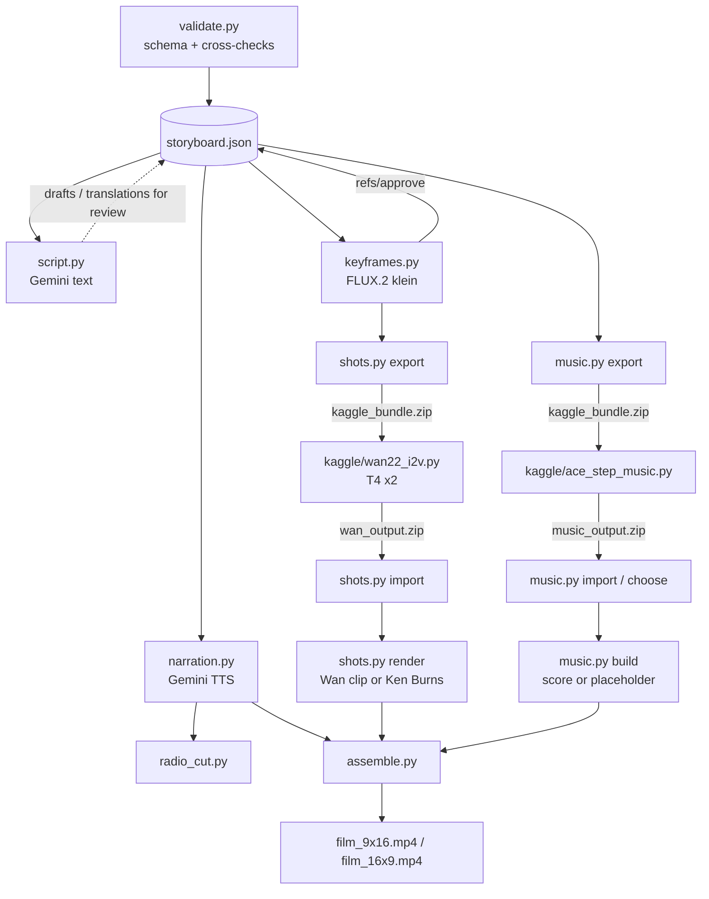

# Architecture

## Principles

1. **One contract.** `storyboard.json` is the only input that describes the film. Every stage reads it, and nothing film-specific (prompts, seeds, durations, voice, cue captions) is hidden in code.
2. **Validate before spending.** Every stage first runs `pipeline/validate.py`: the JSON Schema plus cross-checks the schema cannot express (character and cue ids exist, cues are in order, total length is 60–90 s). A broken storyboard never reaches a model.
3. **One script per stage, files as the interface.** A stage reads the storyboard and upstream files and writes its own files under `outputs/<stage>/`. Stages do not import each other's state, so any stage can be re-run alone.
4. **Regenerate only what changed.** Each output has a `.meta.json` sidecar holding a hash of every input that affects it.
5. **Log every call.** Every model call, including failed attempts, appends one line to `runs.jsonl`.
6. **Always produce a film.** Each GPU stage has a local fallback, so quota or model failures degrade the film instead of stopping it.

## Data flow



## Stage contracts

| Stage | Reads from storyboard | Reads files | Writes | Cache key (hashed) |
|---|---|---|---|---|
| `validate` | everything | schema | exit code | — |
| `script` | brief, schema, subtitles | `story/brief.md` | `outputs/script/*.json` (never overwrites the storyboard unless `--apply`) | not cached: human-reviewed |
| `narration` | `shots[].narration.text`, `narration_settings`, `models.narration` | — | `outputs/narration/<shot>.wav`, `timing.json` | model, voice, style instruction, text |
| `keyframes refs` | `characters[]`, `style_block` | — | `outputs/keyframes/refs/<char>_c<k>.png` | model, prompt, seed, size |
| `keyframes approve` | — | chosen candidate | `refs/<char>.png`, `characters[].reference_image` | — |
| `keyframes shots` | `shots[].keyframe`, characters, style | approved refs | `outputs/keyframes/<shot>.png`, `contact_sheet.jpg` | model, full prompt, seed, size, **hash of each reference image** |
| `shots export` | `shots[].motion`, `models.shots` | keyframes | `outputs/shots/kaggle_bundle.zip` (only stale shots) | model, params, **keyframe file hash**, motion prompt, seed |
| `shots import` | same | Kaggle output | `outputs/shots/<shot>.mp4`, appends `runs.jsonl` | accepts a clip only if its job hash equals the current hash |
| `shots render` | `motion.mode`, `ken_burns` | clips, keyframes | `<shot>_kb.mp4`, `manifest.json` | keyframe hash, direction, amount, duration, fps |
| `music export/import/choose` | `music.cues`, `candidates` | Kaggle output | `outputs/music/candidates/*.wav`, `chosen_candidate` | — |
| `music build` | cues, shot timing, `chosen_candidate` | candidates | `outputs/music/score.wav` | candidate file hashes, cue windows |
| `assemble` | everything | manifest, narration, score | `outputs/final/film_*.mp4`, `assembly_report.json`, SRT | not cached: about 30 s of local FFmpeg |

Because each downstream key includes the **content hash of the upstream file**, a change cascades exactly as far as it should. A new keyframe prompt regenerates that keyframe, makes that shot's Wan clip stale (and exports only that job), and re-renders only that shot's Ken Burns fallback. A changed narration line regenerates one WAV and changes subtitle timing at assembly. Nothing else is touched.

## Logging: `runs.jsonl`

One JSON object per model call, appended:

```json
{"ts": "...", "run_id": "20261125T101500Z-a1b2c3", "stage": "keyframes", "shot_id": "s06",
 "model": "@cf/black-forest-labs/flux-2-klein-4b", "provider": "cloudflare_workers_ai",
 "params": {"w": 1024, "h": 1024, "n_refs": 1}, "seed": 10006, "latency_s": 3.42,
 "gpu_minutes": null, "cost_usd": 0.0, "status": "ok", "attempt": 1,
 "output": "outputs/keyframes/s06.png", "error": null}
```

- Failed attempts are logged with `status: "error"` and the error text, so quota and memory failures are evidence rather than anecdote.
- Kaggle scripts write the same format to `kaggle_runs.jsonl`. `shots.py import` and `music.py import` append those lines (deduplicated), with `gpu_minutes` set to the measured wall time.
- Cache hits are **not** model calls and are not logged. That's why, after `make regen SHOT=s06`, the log shows exactly one new call.
- `pipeline/costs_report.py` aggregates the log into `COSTS.md`.

## Failure handling

| Failure | Handling |
|---|---|
| Transient API error, 5xx | `with_retries`: 3 attempts, exponential backoff (4 s, 8 s), each attempt logged |
| Rate limit / quota (429, `RESOURCE_EXHAUSTED`) | same, with 4× longer waits; the run stops after 3 attempts and the cache keeps everything already made, so re-running resumes |
| Model renamed or retired | model names live in `storyboard.json` and can be overridden in `.env` (`TTS_MODEL`, `KEYFRAME_MODEL`, `TEXT_MODEL`); `MODEL_ID` for Kaggle |
| Kaggle session dies or quota ends | Wan script skips finished clips on restart and stops at `MAX_MINUTES`; `shots.py render` uses a Ken Burns pan/zoom for any shot without a valid clip |
| CUDA out of memory on the T4 | CPU offload by default; the job is logged as an error and the script moves on; lower resolution or frames in the storyboard |
| Stale clip (keyframe changed after export) | rejected at import by hash comparison, listed as stale |
| No chosen music | `music.py build` falls back to the placeholder drone |
| Narration longer than its shot | `timing.json` + warning; durations are fixed in the storyboard, not silently stretched |
| Bad storyboard | validation fails before any call; CI fails on push |
| Secrets | `.env` is git-ignored; CI fails if `.env` or `kaggle.json` is ever committed |

## Picture: one square master, two aspect ratios

Keyframes (1024²) and Wan clips (512² draft) are **square, subject centred**. Assembly crops the centre to 9:16 (720×1280) and 16:9 (1280×720) from the same material. This costs some resolution, but it halves GPU time compared with generating every clip twice. Whether the crop loses important content is an experiment (see `EXPERIMENTS.md`).

Wan clips (about 5 s) are trimmed by 0.3 s at the head and 0.2 s at the tail, where generated clips are often weakest. A clip shorter than its shot is slowed by at most 1.5× and then holds its last frame.

## Sound

1. **Voice track:** each shot's WAV starts 0.4 s into the shot and is padded to the shot's duration, so picture is cut to the voice.
2. **Score:** each cue is placed at its first shot's start time, with 1.5 s crossfades between cues and a 3 s fade under the end card.
3. **Mix:** the music is ducked under the voice with `sidechaincompress` (threshold 0.02, ratio 6, attack 300 ms, release 1500 ms, all from the storyboard).
4. **Loudness:** two-pass `loudnorm` to −14 LUFS integrated, true peak −1 dBTP.

## Subtitles and end card

- Subtitles come from `subtitle_en` and are timed to the **measured** narration, not the planned duration. They're wrapped to at most two lines of about 40 characters.
- They're rendered from an ASS file whose canvas equals the frame size (see `FAILURES.md` F01), placed inside the vertical safe area (17% from the bottom).
- The end card is drawn in code, never by an image model, so the "Made with AI" text is always legible.

## Where the agent helped and where I decided

The stage scripts were written with a coding agent. The storyboard contract, the cache-key design, the fallbacks, the shot reasons and every model choice are mine and are justified in `DESIGN.md` and `EXPERIMENTS.md`.
