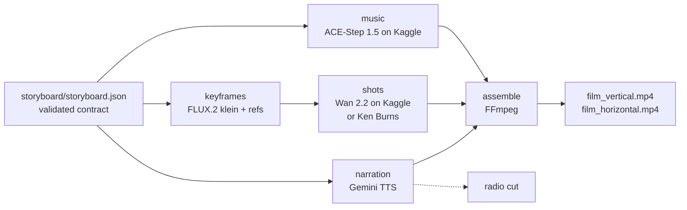

# The Letters She Cannot Read

**A 60–90 second AI-generated short film, and the code pipeline that makes it.**

A mother in a rural Ethiopian village cannot read. For twelve years she keeps every letter from her child in a tin box and has a neighbour's daughter read them to her under the warka tree, until her child comes home and gives her a way to answer in her own voice.

The film is narrated in Amharic with English subtitles, has an original score, and comes in vertical (9:16) and horizontal (16:9). Every frame, line of narration and note of music is generated by this repository from one file: [`storyboard/storyboard.json`](storyboard/storyboard.json).

> Built for the 10 Academy challenge *AI-Content Generation: The Heritage Short* (B2W0).

---

## Regenerate the film with one command

```bash
git clone https://github.com/<your-username>/mom-helper-content-generation-model.git
cd mom-helper-content-generation-model
make install                 # Python deps; ffmpeg must be installed (apt install ffmpeg / brew install ffmpeg)
cp .env.example .env         # add GEMINI_API_KEY, CF_ACCOUNT_ID, CF_API_TOKEN
make film                    # -> output/film_vertical.mp4 and output/film_horizontal.mp4
```

Generated media and their input hashes are committed under `audio/`, `assets/` and `output/`, so on a clean clone `make film` reuses them and makes **no model calls** until you change something in `storyboard/storyboard.json`.

**No keys?** `make film-dry` (or `python src/pipeline.py film --dry-run`) builds the whole film with placeholder narration and frames. CI runs it on every push.

## What it costs

Everything runs on free tiers: the Gemini API free tier (script, narration), the Cloudflare Workers AI daily allowance (keyframes), and Kaggle's weekly GPU quota (Wan 2.2 clips, ACE-Step music). The binding constraint is GPU time, not money. Measured latency, GPU minutes and list-price equivalents are in [COSTS.md](COSTS.md), generated from `logs/runs.jsonl` by `make costs`.

## The pipeline



| Stage | Script | Model, where it runs | Output |
|---|---|---|---|
| Script | `src/script.py` | Gemini 3.8 Flash, Gemini API | storyboard drafts, translations (for review) |
| Narration | `src/generate_audio.py narration` | Gemini 3.8 Flash TTS, Gemini API | `audio/narration/<shot>.wav` |
| Keyframes | `src/generate_images.py` | FLUX.2 [klein] 4B, Cloudflare Workers AI | `assets/images/<shot>.png` |
| Moving shots | `src/generate_video.py` + `kaggle/wan22_i2v.py` | Wan 2.2 TI2V-5B, Kaggle T4 ×2 | `assets/video/<shot>.mp4` |
| Music | `src/generate_audio.py music` + `kaggle/ace_step_music.py` | ACE-Step 1.5, Kaggle T4 | `audio/music/score.wav` |
| Assembly | `src/assemble_film.py` | FFmpeg, local | `output/film_*.mp4` |

Every stage validates `storyboard/storyboard.json` first, reuses any output whose inputs are unchanged, retries failed calls with backoff, and logs every model call to `logs/runs.jsonl`. Details are in [ARCHITECTURE.md](ARCHITECTURE.md).

## Step by step

```bash
make smoke                                   # 1. call each provider once; check what works today
make radio                                   # 2. narration + radio cut -> first user test (DESIGN.md)
make refs                                    # 3. 4 reference-sheet candidates per character
python src/generate_images.py approve mother 2   #  pick the golden reference for each character
make keyframes                               # 4. one keyframe per shot, conditioned on the references
make shots-export                            # 5. bundle for Kaggle -> run kaggle/wan22_i2v.py
python src/generate_video.py import --from ~/Downloads/wan_output.zip
make music-export                            # 6. bundle for Kaggle -> run kaggle/ace_step_music.py
python src/generate_audio.py music import --from ~/Downloads/music_output.zip
python src/generate_audio.py music choose 1 --reason "..."
make film                                    # 7. both aspect ratios, subtitled, ducked, -14 LUFS
make costs                                   # 8. refresh COSTS.md from logs/runs.jsonl
```

Kaggle instructions: [kaggle/README.md](kaggle/README.md).

## Change one shot, regenerate only that shot

Edit one narration line or one keyframe prompt in `storyboard/storyboard.json`, then:

```bash
make regen SHOT=s06
```

Only the changed shot calls a model. Every other shot reports `cached`, and the last lines of `logs/runs.jsonl` show the single new call. This is the live demo in the walkthrough video.

## Repository layout

```
README.md                  this file
STORY.md                   the story in prose, the input to the script stage
DESIGN.md                  audience, intent, shot reasons, both user tests and what they changed
ARCHITECTURE.md            stages, contracts, caching, failure handling
EXPERIMENTS.md             hypothesis -> change -> result
FAILURES.md                what broke, what was tried, what fixed it
COSTS.md                   measured latency and GPU minutes per stage, list-price equivalent
ETHICS.md                  consent, licences of every model and output, labelling plan

storyboard/
  storyboard.json          the story: shots, durations, narration, image/motion prompts, end card
  storyboard.schema.json   its JSON Schema
  pipeline_config.json     what the story does not say: models, seeds, characters, subtitles, music cues, export
  pipeline.schema.json     schema for the two merged together (src/validate.py), checked before every run
prompts/                   every prompt the models receive, generated from the storyboard (make prompts)
  character_reference.md
  image_prompts.md
  motion_prompts.md

audio/
  narration/               one WAV per shot + timing.json
  subtitles/               English SRT
  music/                   ACE-Step candidates and the final score
assets/
  references/              character reference sheets and the approved golden references
  images/                  one keyframe per shot + contact sheet
  video/                   Wan clips, Ken Burns fallbacks, manifest.json

src/
  pipeline.py              the front door: film, film --dry-run, regen, radio, validate, prompts, smoke, costs
  generate_images.py       character references and keyframes (FLUX.2 klein)
  generate_video.py        Wan 2.2 export/import via Kaggle, Ken Burns fallback
  generate_audio.py        narration (Gemini TTS), music (ACE-Step), radio cut
  assemble_film.py         cut, duck, loudness, subtitles, end card, both aspect ratios
  common.py, media.py      shared helpers: paths, caching, logging, retries, FFmpeg building blocks
  validate.py, script.py, smoke_test.py, costs_report.py

tests/                     unit tests (run in CI)
logs/runs.jsonl            one line per model call
output/
  film_vertical.mp4        9:16
  film_horizontal.mp4      16:9
  assembly_report.json, radio_cut/

kaggle/                    GPU scripts for Wan 2.2 and ACE-Step, and how to run them
docs/                      git workflow, report template
```

## Links

- Film (9:16): _add link_
- Film (16:9): _add link_
- Walkthrough video: _add link_
- Public post: _add link_

## Licence

Code: MIT (see [LICENSE](LICENSE)). Generated media: see [ETHICS.md](ETHICS.md) for each model's terms.
