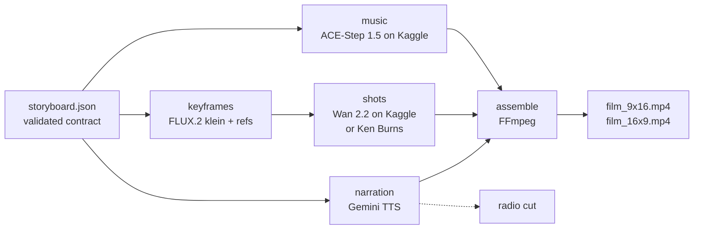

# The Letters She Cannot Read

**A 60–90 second AI-generated short film, and the code pipeline that makes it.**

A mother in a rural Ethiopian village cannot read. For twelve years she keeps every letter from her child in a tin box and has a neighbour's daughter read them to her under the warka tree, until her child comes home and gives her a way to answer in her own voice.

The film is narrated in Amharic with English subtitles, has an original score, and comes in vertical (9:16) and horizontal (16:9). Every frame, line of narration and note of music is generated by this repository from one file: [`storyboard.json`](storyboard.json).

> Built for the 10 Academy challenge *AI-Content Generation: The Heritage Short* (B2W0).

---

## Regenerate the film with one command

```bash
git clone https://github.com/<your-username>/mom-helper-content-generation-model.git
cd mom-helper-content-generation-model
make install                 # Python deps; ffmpeg must be installed (apt install ffmpeg / brew install ffmpeg)
cp .env.example .env         # add GEMINI_API_KEY, CF_ACCOUNT_ID, CF_API_TOKEN
make film                    # -> outputs/final/film_9x16.mp4 and outputs/final/film_16x9.mp4
```

Generated outputs and their input hashes are committed under `outputs/`, so on a clean clone `make film` reuses them and makes **no model calls** until you change something in `storyboard.json`.

**No keys?** `make film-dry` builds the whole film with placeholder narration and frames. CI runs it on every push.

## What it costs

Everything runs on free tiers: the Gemini API free tier (script, narration), the Cloudflare Workers AI daily allowance (keyframes), and Kaggle's weekly GPU quota (Wan 2.2 clips, ACE-Step music). The binding constraint is GPU time, not money. Measured latency, GPU minutes and list-price equivalents are in [COSTS.md](COSTS.md), generated from `runs.jsonl` by `make costs`.

## The pipeline



| Stage | Script | Model, where it runs | Output |
|---|---|---|---|
| Script | `pipeline/script.py` | Gemini 3.8 Flash, Gemini API | storyboard drafts, translations (for review) |
| Narration | `pipeline/narration.py` | Gemini 3.8 Flash TTS, Gemini API | `outputs/narration/<shot>.wav` |
| Keyframes | `pipeline/keyframes.py` | FLUX.2 [klein] 4B, Cloudflare Workers AI | `outputs/keyframes/<shot>.png` |
| Moving shots | `pipeline/shots.py` + `kaggle/wan22_i2v.py` | Wan 2.2 TI2V-5B, Kaggle T4 ×2 | `outputs/shots/<shot>.mp4` |
| Music | `pipeline/music.py` + `kaggle/ace_step_music.py` | ACE-Step 1.5, Kaggle T4 | `outputs/music/score.wav` |
| Assembly | `pipeline/assemble.py` | FFmpeg, local | `outputs/final/film_*.mp4` |

Every stage validates `storyboard.json` first, reuses any output whose inputs are unchanged, retries failed calls with backoff, and logs every model call to `runs.jsonl`. Details are in [ARCHITECTURE.md](ARCHITECTURE.md).

## Step by step

```bash
make smoke                                   # 1. call each provider once; check what works today
make radio                                   # 2. narration + radio cut -> first user test (DESIGN.md)
make refs                                    # 3. 4 reference-sheet candidates per character
python pipeline/keyframes.py approve mother 2   #  pick the golden reference for each character
make keyframes                               # 4. one keyframe per shot, conditioned on the references
make shots-export                            # 5. bundle for Kaggle -> run kaggle/wan22_i2v.py
python pipeline/shots.py import --from ~/Downloads/wan_output.zip
make music-export                            # 6. bundle for Kaggle -> run kaggle/ace_step_music.py
python pipeline/music.py import --from ~/Downloads/music_output.zip
python pipeline/music.py choose 1 --reason "..."
make film                                    # 7. both aspect ratios, subtitled, ducked, -14 LUFS
make costs                                   # 8. refresh COSTS.md from runs.jsonl
```

Kaggle instructions: [kaggle/README.md](kaggle/README.md).

## Change one shot, regenerate only that shot

Edit one narration line or one keyframe prompt in `storyboard.json`, then:

```bash
make regen SHOT=s06
```

Only the changed shot calls a model. Every other shot reports `cached`, and the last lines of `runs.jsonl` show the single new call. This is the live demo in the walkthrough video.

## Repository layout

```
storyboard.json          the contract: shots, durations, prompts, seeds, narration, music cues
schema/                  JSON Schema for the storyboard, validated before every run
pipeline/                one script per stage + shared helpers (common.py, media.py)
kaggle/                  GPU scripts for Wan 2.2 and ACE-Step, and how to run them
tests/                   unit tests (run in CI)
story/brief.md           the story in prose, the input to the script stage
runs.jsonl               one line per model call
outputs/                 generated images, audio and video, with .meta.json input hashes
DESIGN.md                audience, intent, shot reasons, both user tests and what they changed
ARCHITECTURE.md          stages, contracts, caching, failure handling
EXPERIMENTS.md           hypothesis -> change -> result
FAILURES.md              what broke, what was tried, what fixed it
COSTS.md                 measured latency and GPU minutes per stage, list-price equivalent
ETHICS.md                consent, licences of every model and output, labelling plan
docs/                    git workflow, report template
```

## Links

- Film (9:16): _add link_
- Film (16:9): _add link_
- Walkthrough video: _add link_
- Public post: _add link_

## Licence

Code: MIT (see [LICENSE](LICENSE)). Generated media: see [ETHICS.md](ETHICS.md) for each model's terms.
